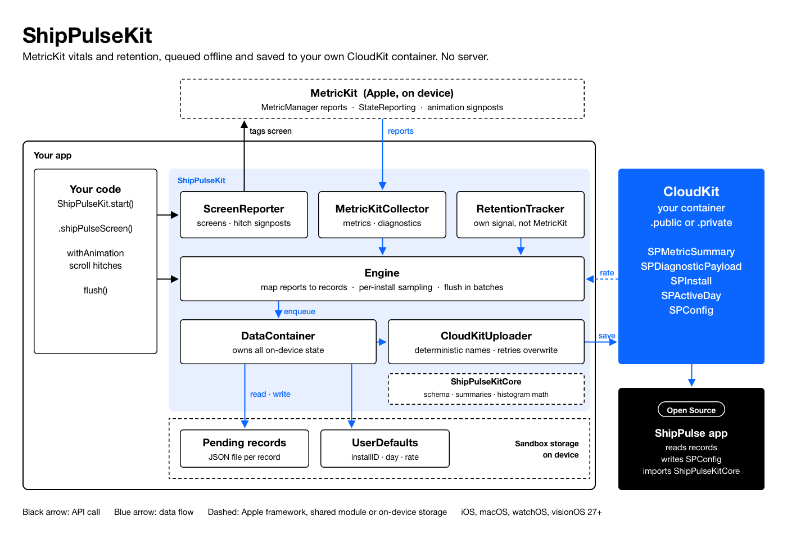

# ShipPulseKit

Drop-in Swift package that sends your app's MetricKit vitals, hitches, diagnostics and
anonymous retention to **your own CloudKit container**. There is no server.
[ShipPulse](https://github.com/ShawnBaek/ShipPulse) reads them, even for apps too small for
App Store Connect analytics.

**Pure MetricKit approach.** Every vital, including hitches, launch time, hangs and memory,
is measured by Apple's MetricKit, not by the SDK. ShipPulseKit adds no frame timers or
measurements of its own, so its numbers match Xcode Organizer. The SDK only forwards
MetricKit reports, marks screens and regions for MetricKit to attribute, and records
anonymous retention.

Requires iOS, macOS, watchOS or visionOS 27+. Test on a physical device; MetricKit doesn't
report in the Simulator. visionOS has no daily metric reports, so it sends diagnostics and
retention only. watchOS has no MetricKit, so it sends retention only.

MetricKit is weak-linked, so an OS seed that lacks part of its Swift API can't crash your app
at launch. There, `start()` does nothing and the other APIs have no effect. You don't need a
linker setting or a check of your own, but if your app also imports MetricKit and uses a
missing symbol, your own reference still has to be weak-linked.

**Integrating with an AI coding agent?** Point it at
[`skills/integrate-shippulsekit/SKILL.md`](skills/integrate-shippulsekit/SKILL.md), or copy
that folder into your project's agent skills (for Claude Code, `.claude/skills/`). It walks
the agent through choosing the container, starting the SDK, installing the CloudKit schema
safely, and checking that records arrive.

## Architecture



- **Collectors** turn MetricKit reports and app launches into records.
- **Engine** applies per-install upload sampling and hands records to **DataContainer**, the only owner of
  on-device state: pending records and a few UserDefaults keys.
- **CloudKitUploader** saves pending records to your CloudKit container. A record leaves the
  device only after CloudKit accepts it.

Source: [docs/design/ShipPulseKit-Architecture.sketch](docs/design/ShipPulseKit-Architecture.sketch).

## 1. Enable CloudKit

1. Pick a container. **The container your app already uses is fine.** ShipPulseKit only adds
   `SP`-prefixed record types to the public database (the default). It doesn't touch your
   record types, your records or your private database, so Core Data or SwiftData sync keeps working.
   - **Your app already has iCloud with CloudKit:** there is nothing to configure. Call
     `start()` without arguments and the SDK uses the first container in your entitlements.
   - **You want a separate container** (to keep metrics apart, or because the first
     container in your entitlements isn't the one you want): in Xcode, open
     **Signing & Capabilities → + iCloud**, check **CloudKit** and add it, on every
     platform target that runs the SDK. Then pass it to
     `Configuration(containerIdentifier:)`.
2. Import [`CloudKit/ShipPulseKit.ckdb`](CloudKit/ShipPulseKit.ckdb) into the
   **Development** environment with `xcrun cktool import-schema`. Import **replaces** the
   environment's whole schema, so export the current schema and merge the file into it
   first. That keeps your existing record types and the default `Users` type. The commands are in
   [docs/CloudKitSchema.md](docs/CloudKitSchema.md#installing-the-schema).
3. Before your first TestFlight or App Store build, deploy the schema to **Production**:
   CloudKit Console → your container → **Deploy Schema Changes**. Debug builds write to the
   Development environment; TestFlight and App Store builds write to Production. Until the
   schema is in Production, nothing arrives: release builds keep records on the device for up
   to 30 days (at most 500 records), then drop the oldest. In a shared container, Deploy
   ships *every* pending Development change, so check that the diff lists only the
   ShipPulseKit role and record types (plus the `Users` index from step 4, if you added it).
4. Optional: give your own iCloud user the `ShipPulseAdmin` role, in each environment. You only need it to change
   sampling rates or delete old records; collecting and reading work without it. The
   **Security Roles** page defines what the role can do; it doesn't assign it. To assign
   it, open the environment's **Records** page, query `Users` in the public database, and
   add the role to your user record. If that query fails, `Users` has no queryable
   `recordName` index; add one in Development and deploy it. Your user record exists only
   after your iCloud account has used the container in that environment.

If automatic signing fails with "iCloud Container … is not available", the App ID may still
be linked to a container that no longer exists on your team. Remove the iCloud capability
from the App ID in the developer portal and add it back to clear the stale link.

### What the schema adds

One role and five record types, all in the container's **public** database.

| Record type | One record per | Key fields |
| --- | --- | --- |
| `SPMetricSummary` | install and MetricKit report (about a day) | Queryable: `bundleID`, `build`, `device`, `timeBegin`, `isTestFlight`. Payload: `summary` (every metric) and `report` (raw MetricKit JSON), both zlib |
| `SPDiagnosticPayload` | crash, hang, launch, CPU, disk-write or memory diagnostic | Queryable: `kind`, `durationMs`, `terminationCategory`, `signal`, `exceptionType`. Payload: `payload` (call stacks, zlib JSON) |
| `SPInstall` | install | `installID`, `firstLaunch`: the denominator for retention |
| `SPActiveDay` | install and UTC day the app was opened | `day`, `daysSinceInstall`: the numerator for retention |
| `SPConfig` | app | `sampleRate`, `diagnosticSampleRate`, which the SDK reads once a day |

The four SDK types also carry `bundleID`, `appVersion`, `build`, `osVersion`, `device` and
`sampleRate`.

Permissions:

- `_icloud` can **create** records of the four SDK types, so any device signed in to iCloud
  adds its own.
- `_creator` can **write** only the records it created, so retried uploads overwrite instead
  of duplicating.
- `_world` can **read**, so the ShipPulse app can read with your container's API token.
- `ShipPulseAdmin` is the role you assign to your own iCloud user. It can write every type,
  to prune old records, and it is the only role that can create or write `SPConfig`, so
  nobody else can change your sampling rates.

Full field list and queries: [docs/CloudKitSchema.md](docs/CloudKitSchema.md).

Without a usable container, `start()` throws a `ShipPulseKitError` whose `code` is
`.iCloudContainerUnavailable` instead of crashing. CloudKit raises an Objective-C exception in that case, which Swift
can't catch; ShipPulseKit catches it and rethrows it as this error, so your app keeps
running without metrics.

## 2. Install

```swift
.package(url: "https://github.com/ShawnBaek/ShipPulseKit.git", from: "0.2.1")
```

## 3. Start

**SwiftUI**

```swift
@main
struct MyApp: App {
    init() {
        do { try ShipPulseKit.start() }
        catch { print(error.localizedDescription) }   // app runs on without metrics
    }
    var body: some Scene { WindowGroup { ContentView() } }
}
```

**UIKit**

```swift
func application(_ application: UIApplication,
                 didFinishLaunchingWithOptions launchOptions: [UIApplication.LaunchOptionsKey: Any]?) -> Bool {
    do { try ShipPulseKit.start() } catch { print(error.localizedDescription) }
    return true
}
```

That's all you need. Every MetricKit metric and diagnostic is collected, along with
retention. UIKit screens are tracked automatically: ShipPulseKit swizzles
`UIViewController.viewDidAppear(_:)` to report each content view controller's class name.
Turn it off with `Configuration(tracksScreensAutomatically: false)`.

## Optional: screens and regions

```swift
FeedView().shipPulseScreen()                       // per-screen metrics, named after the file

List(photos) { PhotoRow($0) }
    .shipPulseScrollHitches("PhotoFeed")           // SwiftUI: hitch time while scrolling

collectionView.shipPulseTrackScrollHitches("PhotoFeed")   // UIKit

ShipPulseKit.withAnimation("CardFlip", .spring) { flipped.toggle() }
```

More APIs: [docs/HitchTracking.md](docs/HitchTracking.md).

## Custom CloudKit

```swift
try ShipPulseKit.start(Configuration(
    containerIdentifier: "iCloud.com.example.metrics", // default: first container in entitlements
    database: .public                                  // .private = each user's own iCloud
))
```

With `.private`, records still go to iCloud, but into each user's own private database, so
neither you nor the ShipPulse app can read other users' data; dashboards and benchmarks need
`.public`.

Other options: `collectsMetrics`, `collectsDiagnostics`, `tracksRetention`, `sampling`,
`diagnosticSampling`, `additionalStateDomains`, `tracksScreensAutomatically`, `maxPendingRecordAge`
(default 30 days) and `maxPendingRecords` (default 500).

## Data format

Each device sends one `SPMetricSummary` per day. Its `summary` field is zlib-compressed JSON:

```json
{
  "schemaVersion": 1,
  "overall": {
    "histograms": { "timeToFirstDraw": { "buckets": [{ "start": 0, "end": 500, "count": 41 }] } },
    "values": { "hitchTime.ratio": 0.0041, "peakMemory.mb": 182.4 },
    "counts": { "foregroundTermination.watchdog": 0 }
  },
  "states": [
    { "domain": "shippulse.screen", "label": "Feed/FeedView.swift",
      "metrics": { "values": { "hitchTime.ratio": 0.0072 } } }
  ]
}
```

Other record types: `SPDiagnosticPayload` (crash, hang and launch call stacks),
`SPInstall` and `SPActiveDay` (retention). Full field
list: [docs/CloudKitSchema.md](docs/CloudKitSchema.md).

## Samples

`Examples/SwiftUISample` and `Examples/UIKitSample` show the same flow: launch tracking, a
home list, a photo grid (collection view) and a photo list (table view), each with screen and
hitch measurement. Open the sample's `.xcodeproj`, set your team, and run it on a device.

## Privacy

The SDK sends no IDFA, IDFV or app user data, and makes no network calls outside CloudKit.
Diagnostics are sent without Objective-C exception messages or arguments, which could
contain user data.

Each install gets a random ID kept in UserDefaults; it is per app, never shared across apps,
and reset when the app is deleted.

By default, records go to your container's public database, readable by any client of that
container.
CloudKit stamps each record with the creator's container-scoped user record ID
(`___createdBy`), which links records from one iCloud account. For the privacy label,
declare *Diagnostics → Performance Data* and *Crash Data*, used for app functionality and
analytics, not for tracking. Whether you also mark them linked to identity depends on your
own policy; see [docs/CloudKitSchema.md](docs/CloudKitSchema.md#privacy).

## License

Apache-2.0
